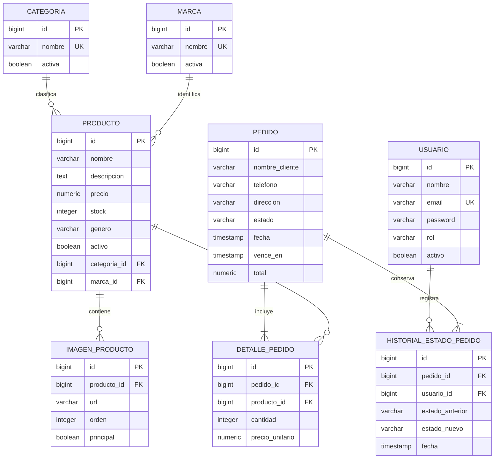

# Diagrama entidad-relación

El script fuente es [`../db/SeyFert.sql`](../db/SeyFert.sql). La relación entre detalle y producto conserva el precio unitario histórico para que un cambio posterior al precio del catálogo no modifique el total previamente solicitado.
